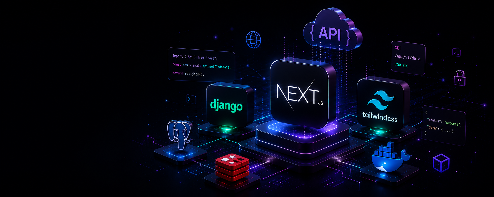

# 

<h1 align="center">Hi, I'm Sina Pirzadeh 👋</h1>

<h3 align="center">Software Engineer · Full Stack Developer</h3>

  Building scalable web applications with Next.js, TypeScript and NestJS.

  <a href="https://pirroot.site">Portfolio</a> ·
  <a href="https://linkedin.com/in/pirroot">LinkedIn</a> ·
  <a href="mailto:pirzadehroot@gmail.com">Email</a>

---

### About

I'm a Full Stack Developer focused on building modern web applications, scalable APIs, and clean software architecture.

Currently exploring Python, FastAPI and AI engineering.

### Tech Stack

  

---

### GitHub Metrics

  

---

  <i>Building, learning, and shipping.</i>

