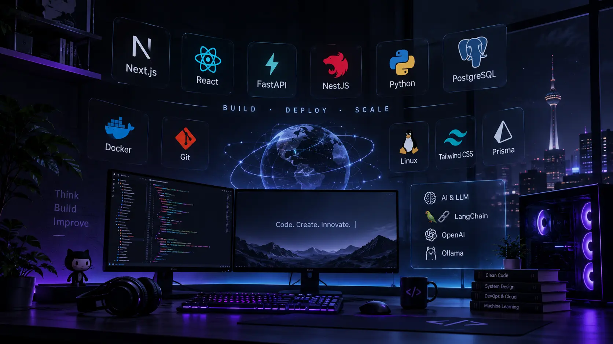

  

<h1 align="center">Hi, I'm <a href="https://pirroot.site">Sina Pirzadeh</a></h1>

<h3 align="center">Full-Stack Developer · Next.js · FastAPI · NestJS</h3>

  6+ years building fast, SEO-friendly web apps and online stores, 
  and now moving deeper into Python and AI engineering.

  <a href="https://pirroot.site">Portfolio</a> ·
  <a href="https://linkedin.com/in/pirroot">LinkedIn</a> ·
  <a href="https://github.com/pirroot/pirroot/raw/main/resume.pdf">Résumé</a> ·
  <a href="https://t.me/pirroot">Telegram</a>

---

### About

- Full-stack work with Next.js, FastAPI, NestJS and PostgreSQL
- Focus: performance, technical SEO, and code that stays maintainable months later
- Currently learning: AI engineering and building with LLMs

### Featured Projects

- **[Iran Package](https://iranpakage.com/)**: education + e-commerce platform. Next.js, FastAPI
- **[Bellanzo](https://bellanzo-home.ir/)**: modern online store with a technical-SEO focus. Next.js, PostgreSQL
- **[Rahkar Javan](https://rahkarjavan.ir/)**: news platform with content management and SEO. Next.js, PostgreSQL
- **[Raya](https://github.com/pirroot/Raya)**: education platform. Next.js, Django REST Framework

### Tech Stack

  

---

### GitHub Metrics

  

---

  <i>Building, learning, and shipping.</i>

